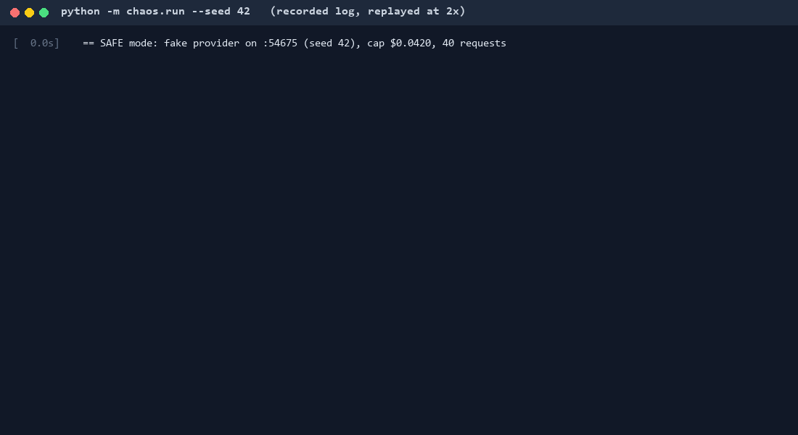
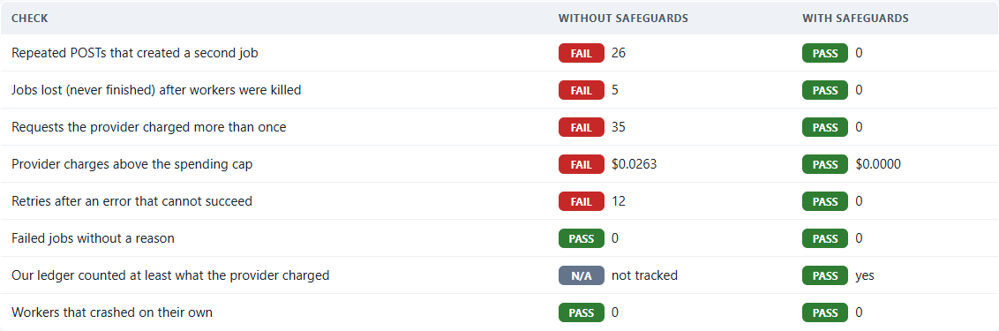
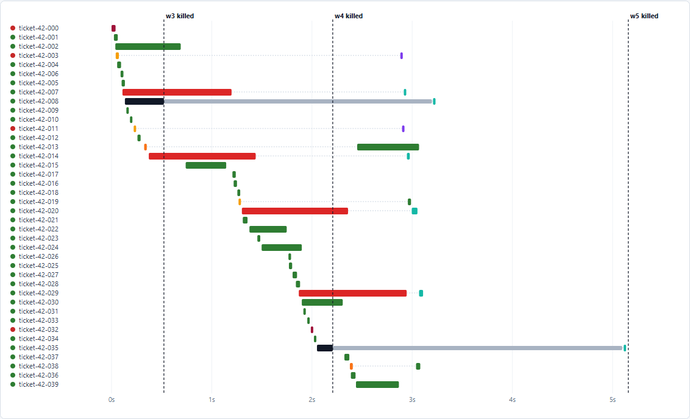
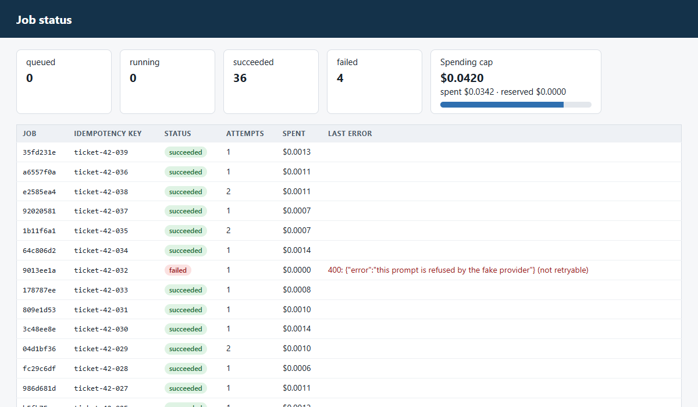
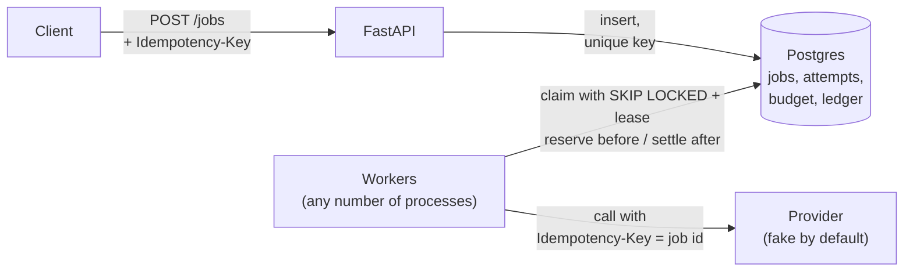
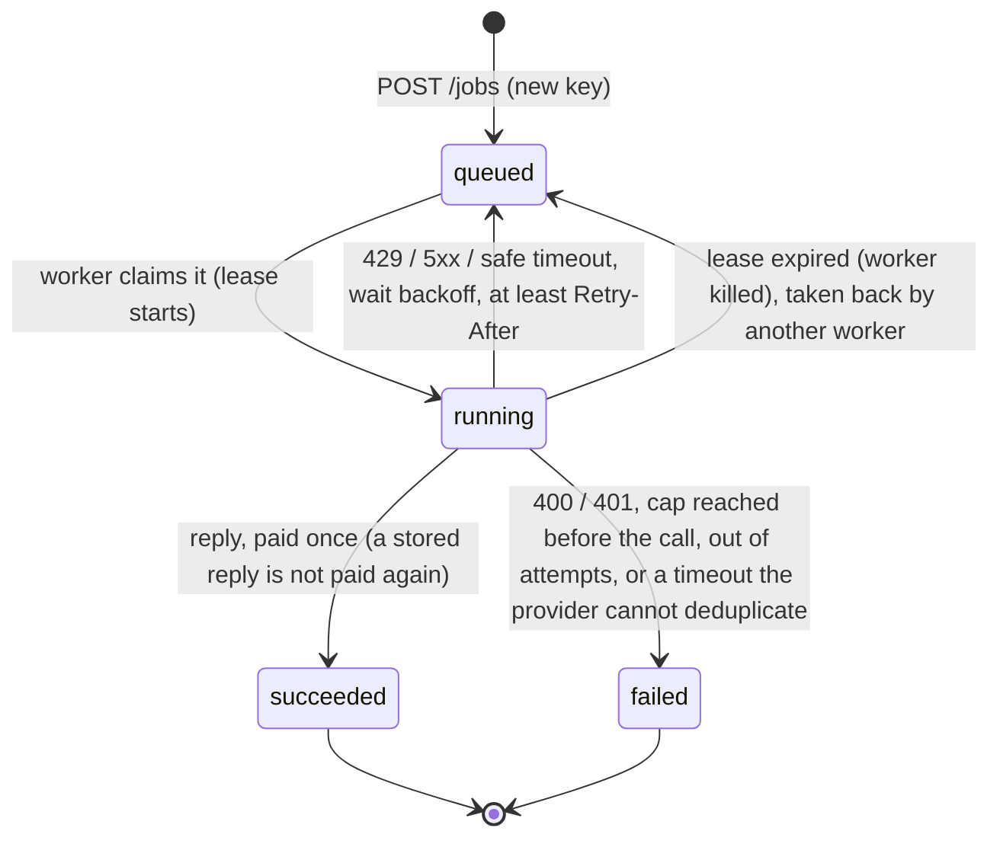

# reliable-ai-jobs-api

AI generation jobs that retry safely, survive crashed workers and never go over a spending cap.

**Typical request we see:** an AI feature (text, clips, summaries) runs as background jobs against a
model provider that sometimes times out, rate-limits or fails. Jobs get stuck, users click "retry" and
get two results, and the team is not sure whether the provider billed them twice. They want it
fixed so it runs in parallel, retries on its own, and never pays twice for the same work.

This repo is an **open-source demo** of how I build that. The workload is fictional (support replies
for "Brightline Desk Co.", a **fictional company**) and the model provider is a **fake one that fails on
purpose**: timeouts, 429 with Retry-After, 500, slow replies and duplicate replies, all chosen from a
seed so a run can be repeated. Nothing needs an API key or a cloud account. A real OpenAI or Anthropic
provider can be switched on with environment variables (see Limits).



*The GIF replays the log that `python -m chaos.run` printed on the machine this was built on (fake
provider, seed 42). Raw output: [`docs/chaos-run-output.txt`](docs/chaos-run-output.txt).*

## What it shows

- **A repeated request never creates a second job.** `POST /jobs` needs an `Idempotency-Key`
  header. The same key returns the same job (HTTP 200), even with many copies sent at the same time;
  the same key with a different body is refused (409). Enforced by a unique index, not by a
  "check then insert" in code.
- **Retries only when a retry is safe.** 429, 5xx and "could not connect" are retried with exponential
  backoff and jitter, never earlier than the provider's `Retry-After`. A 400 or 401 fails at once with
  a clear message. A timeout is retried only if the provider deduplicates by idempotency key;
  otherwise the job fails and says why ("not retried to avoid paying twice").
- **No job is lost when a worker dies mid-call.** Workers claim jobs with
  `SELECT ... FOR UPDATE SKIP LOCKED` and a lease. If a worker is killed (`kill -9`), another worker
  takes the job back when the lease expires. A late result from a worker that lost its lease is
  discarded.
- **A spending cap that is checked before every call.** Each call first reserves its worst-case cost
  in a Postgres ledger; if that would go over the cap, the call is not made. After the call the
  reservation is settled once (idempotent). Calls whose outcome is unknown (timeout, crashed worker)
  are counted as spent until the provider confirms the real charge.
- **Dry-run mode.** `DRY_RUN=1` (or `"dry_run": true` per job) runs the whole pipeline without
  calling the provider and returns what would have been sent and its worst-case cost.
- **A chaos run anyone can repeat.** `python -m chaos.run` runs the same 40 requests twice, with
  this repo's workers and with a deliberately naive worker, kills workers mid-call, and writes a
  static report: [`report/chaos.html`](report/chaos.html).

## Chaos run results

Same requests, same seed, same provider faults; the only difference is the worker code.
Reproduced by `python -m chaos.run --seed 42` (40 requests sent as 66 POSTs, because the fake client
repeats some of them; 4 workers; cap $0.0420 with illustrative prices):

| Check | Without safeguards (`chaos/naive_worker.py`) | With safeguards (`jobsapi/worker.py`) |
|---|---|---|
| Repeated POSTs that created a second job | **26** | 0 |
| Jobs lost (never finished) after workers were killed | **5** | 0 |
| Requests the provider charged more than once | **35** | 0 |
| Provider charges above the spending cap | **$0.0263** | $0.0000 |
| Retries after an error that cannot succeed | **12** | 0 |
| Failed jobs without a reason | 0 | 0 |
| Our ledger counted at least what the provider charged | not tracked | yes (ledger and bill both $0.0342) |
| Workers that crashed on their own | 0 | 0 |

With safeguards: 36 jobs succeeded, 2 were refused by the fake provider (`[reject]` prompts, a
permanent error, tried once) and 2 were refused by the spending cap before any call. The cap is set
on purpose below what all 40 requests could cost in the worst case.



The whole report as one image: [`docs/chaos-report.png`](docs/chaos-report.png).

The timeline in the report shows each attempt as a bar: killed workers (black), the wait until the
lease expires (grey), and the retry that receives the provider's stored reply instead of paying again
(teal).



Which worker gets killed, and when, depends on timing, so the counts move a little between runs. The
checks in the right-hand column must pass on every run: `chaos.run` exits with an error otherwise,
and `tests/test_chaos.py` runs a smaller version of it.

## Run it

Requirements: Docker with Compose.

```bash
docker compose up -d --build          # Postgres, API on http://localhost:8000, 2 workers, fake provider
docker compose run --rm chaos         # chaos run -> ./report/chaos.html
docker compose run --rm tests         # test suite
```

Submit a job and read it back:

```bash
curl -s -X POST localhost:8000/jobs -H "Content-Type: application/json" \
     -H "Idempotency-Key: order-1042-reply" \
     -d '{"prompt": "Reply to a customer asking where order 1042 is.", "max_tokens": 200}'
curl -s localhost:8000/jobs/<id>      # status, result, spend and every attempt
curl -s localhost:8000/budget         # cap, reserved, spent, remaining
```

Run the same request again with the same key and you get the same job back. An example of a job that
survived a killed worker, as the API returns it: [`docs/example-job.json`](docs/example-job.json).

`http://localhost:8000/` is a plain page that lists the jobs and the spending cap (it refreshes every
2 seconds); interactive API docs are at `/docs`.



**Without Docker for the Python side** (Python 3.11+; Postgres still from `docker compose up -d db`):

```bash
python -m venv .venv && .venv/bin/pip install -r requirements-dev.txt   # Windows: .venv\Scripts\pip
.venv/bin/python -m pytest
.venv/bin/python -m chaos.run          # or: --mode safe, --seed 7, --jobs 80, --kills 10
```

**Real provider (optional):** copy `.env.example` to `.env`, set `PROVIDER=openai` or
`PROVIDER=anthropic`, `LLM_MODEL` (a model id from your provider's docs), the matching API key and your
real prices per token (`PRICE_IN_MICROS`, `PRICE_OUT_MICROS`), then `docker compose up -d --build`.
Start with `DRY_RUN=1` and a small `BUDGET_CAP_MICROS`.

## How it works



A job's life:



Each attempt runs in three steps (`jobsapi/worker.py`):

1. **One transaction:** record the attempt and reserve its worst-case cost in the ledger. If the cap
   would be exceeded, the job fails here and the provider is never called.
2. **The provider call**, outside any transaction (no locks held while waiting), with the job id as
   idempotency key.
3. **One transaction:** close the reservation (settle the real cost, release it on a 429/5xx, or count
   all of it when the outcome is unknown), then update the job only if this worker still owns the
   lease. When a deduplicating provider replies, the reply states the job's one real charge, and
   what earlier unknown attempts had counted on top of it is given back (once).

Code map: `jobsapi/api.py` (API), `jobsapi/worker.py` (claim, lease recovery, the three steps),
`jobsapi/ledger.py` (reserve, close, reconcile), `jobsapi/retry.py` (what is retryable, backoff),
`jobsapi/providers.py` (fake, OpenAI, Anthropic over plain HTTP), `jobsapi/schema.sql`,
`fakeprovider/` (the unreliable provider), `chaos/` (chaos run, naive worker, report).

## Tests

```bash
python -m pytest              # all tests (needs Postgres: docker compose up -d db)
python -m pytest -m "not slow"   # skips the two tests that start real processes
```

Last run on the machine this was built on (Windows 11, Python 3.13, Postgres 16 in Docker); the same
suite also passed inside the container with `docker compose run --rm tests`:

```text
$ python -m pytest
............................................                             [100%]
44 passed in 89.68s (0:01:29)
```

What they cover:

- `test_retry.py`: which errors are retried; property tests (hypothesis) that the backoff stays under its
  ceiling and is never earlier than `Retry-After`.
- `test_ledger.py`: reserve, settle, release and reconcile; 20 threads racing for a budget that fits 7
  reservations (exactly 7 win); a property test that, for any sequence of operations,
  `spent + reserved <= cap` and the budget row equals what the ledger rows say.
- `test_idempotency.py`: property test that N identical POSTs make exactly 1 job; 16 concurrent copies
  make 1 job; same key with another body is 409; over-budget jobs are not created.
- `test_worker.py`: 429/500 retried, 400 not, give up after the last attempt, timeout then stored reply
  (paid once), timeout with a provider that cannot deduplicate (not retried), dry run (provider never
  called), cap reached (no call made), a worker that dies mid-call, a frozen worker whose late result
  is discarded.
- `test_crash.py`: real worker process killed with `kill -9` while its call is in flight; a second
  worker recovers the job; the provider bill shows one charge.
- `test_chaos.py`: a small chaos run; every check passes for the safeguarded worker and the naive one
  shows duplicate jobs and duplicate charges.

## How it fails safely

- **Unknown means spent.** After a timeout or a crash nobody knows if the provider charged, so the
  ledger counts the whole reservation. It is given back only when a deduplicating provider confirms the
  real charge.
  The ledger can over-count for a while; it never under-counts.
- **The cap is checked before the call, under a lock.** Concurrent workers queue on the budget row, so
  two of them cannot both take the last slot of budget.
- **No retry that could pay twice.** Without provider-side deduplication, an unknown outcome is not
  retried; the job fails with a message that says so, and a person decides.
- **Every failure has a reason** a person can read: "gave up after 5 attempts; last error: 500 from
  provider", "spending cap reached: this call may cost up to ... Provider not called.", and so on.
- **Late results cannot overwrite newer ones.** Step 3 checks that the job is still `running`, on the
  same attempt, owned by the same worker.
- **The demo cannot spend money.** The default provider is the local fake. Real providers need an
  explicit `PROVIDER`, model and key, and `DRY_RUN=1` is there to try the pipeline first.

## Design decisions and trade-offs

- **Postgres as the queue, not Redis or a broker.** Jobs, attempts and money live in one database, so a
  job's state change and its ledger entry commit together. `SKIP LOCKED` lets workers claim jobs
  without blocking each other. Trade-off: a dedicated queue scales further; for most AI features the
  provider is the bottleneck, not the queue.
- **Lease instead of heartbeat.** A provider call always finishes or times out well inside the lease
  (the config refuses `LEASE_SECONDS < 2 * PROVIDER_TIMEOUT + 1`), so no heartbeat thread is needed.
  Trade-off: a killed worker's job waits up to one lease before it is taken back (grey bars in the
  timeline).
- **Worst-case reservation.** The reservation assumes the whole prompt at about 3 characters per token
  plus every allowed output token, so it is usually larger than the real cost. Near the cap, jobs can
  be refused while the real spend still has room, because calls in flight hold their worst case.
  That is the price of a cap that cannot be overshot.
- **Plain HTTP for OpenAI and Anthropic**, no SDKs. The error mapping (what is retryable, what may have
  been charged) is the important part and is the same code for every provider. SDKs have their own
  retry logic, which would hide attempts from the ledger.
- **Retry after a lost lease starts a new attempt number.** The attempt number fences stale workers;
  the provider idempotency key stays the job id, so a deduplicating provider still sees one request.

## Limits

- **No real provider was called.** There is no API key on the machine this was built on. The OpenAI and
  Anthropic adapters are plain HTTP clients written from the public API docs and are not exercised by
  the tests. Their prices are not built in: you set them.
- **The "never pay twice" guarantee depends on the provider.** The fake provider deduplicates by
  `Idempotency-Key`. The OpenAI and Anthropic adapters are marked as not deduplicating, so a timeout
  there is not retried (the job fails and says why). The cap and the ledger still hold.
- **Not built:** authentication on the API, multiple budgets (per customer or per day), streaming
  replies, provider-side usage reconciliation (comparing the ledger with the provider's billing export),
  and a lease renewal for calls longer than the lease.
- The fake provider is a model of typical failures, not a copy of any provider. It does not simulate
  partial streaming or a reply that arrives after the connection drops.
- The chaos run uses one machine and one Postgres. Worker kills use `Popen.kill()` (SIGKILL on Linux,
  TerminateProcess on Windows). Network partitions between workers and the database are not simulated.
- Tested with Postgres 16 and Python 3.12 (container) and 3.13 (local).

## Adapting this to your stack

1. Keep your API; add the `Idempotency-Key` contract and the unique index on your jobs table.
2. Put your provider call behind the same three steps: reserve, call, settle. Map its errors in one
   place (`providers.py`), deciding for each one whether it is retryable and whether it may have been
   charged.
3. If your provider supports idempotency keys or request ids you can look up, mark it as deduplicating;
   otherwise keep timeouts as "fail and tell a person".
4. Set the cap per what you can afford to lose in a bad hour, not per month; start with `DRY_RUN=1`.
5. Run `chaos.run` in CI against your worker code with your own failure rates.

## Repo map

| Path | What |
|---|---|
| `jobsapi/` | API, worker, ledger, retry rules, provider adapters, schema, status page |
| `fakeprovider/` | Deliberately unreliable provider (seeded), as a library and an HTTP server |
| `chaos/` | Chaos run, naive worker for comparison, HTML report |
| `tests/` | pytest + hypothesis |
| `report/` | Last chaos report (`chaos.html`) and its data (`chaos.json`) |
| `docs/` | GIF, screenshots, raw chaos output, example job |
| `scripts/` | GIF builder (Pillow) and screenshot helper (playwright-core, optional) |

## License

MIT, see [LICENSE](LICENSE).
